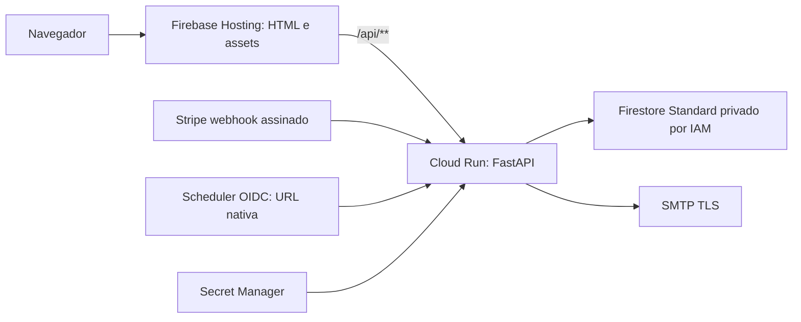

# Auditoria e arquitetura

Auditoria de 16/10/2026, antes das adaptações desta revisão. Nenhum acesso a contas,
dados de produção ou infraestrutura autenticada. Estado inicial do Git limpo.

## Evidências e diagnóstico inicial

| Severidade | Fato verificado / evidência | Impacto e ação |
|---|---|---|
| Alta / bloqueio de cutover | `frontend/index.html` referencia `/edital-de-projetos`, `/programa-bolsa-de-permanencia`, `/quem-somos`; só há duas páginas locais | Migrar conteúdo/documentos Wix e aprovar mapa de redirects antes de DNS. Não substituir tudo por redirect à home. |
| Alta / release | `.github/workflows/deploy.yml` escolhia produção em push de main | Executar staging primeiro; produção somente por despacho explícito e environment protegido. |
| Alta / configuração externa | Projetos, IAM, segredos, índices, SMTP, billing e domínio não verificados | Bootstrap autorizado e validação em staging são gates de lançamento. |
| Média / arquitetura | `firebase.json` só configurava Firestore; Docker servia também HTML | Servir `frontend/` diretamente no Hosting, rewrite somente API. SSR não existe nem é necessário. |
| Média / SEO | Sem canonical, Open Graph, sitemap ou robots locais | Acrescentar metadados para as duas rotas existentes. Inventário Wix continua pendente. |
| Média / operação | Logs textuais de erro, sem identificação/latência de requisição | JSON com ID gerado pelo servidor, rota normalizada, status e duração; sem payloads, query ou tokens. |
| Média / abuso | `allow_intent` limita criações globalmente via transação Firestore; leituras de status e readiness são públicas | Limite preservado; alerta de 429/volume/custo. Não é proteção contra DDoS nem teto de gastos. |
| Média / retenção | TTL apenas em pendências/rate limits; intents, tokens e histórico permanecem | Aprovar retenção e eliminação administrativa reconciliada, sem remover deduplicação de pagamentos ativos. |
| Média / questionário | Firestore não guarda PII pendente; `/finalize` depende de sessionStorage | Perda da sessão pode deixar pagamento sem cadastro. Preservar regra e reconciliar com atendimento. |
| Média / email | SMTP e marcador de envio não são atômicos | Lease/retry já existentes; possível email duplicado após interrupção. |
| Média / jurídico | CPF e opt-in existem, mas política publicada/finalidade/prazo não estão comprovados | Responsável institucional deve aprovar política e atendimento antes do lançamento. |
| Baixa / ferramentas | Sem lint/type checker Python configurados; ferramentas de teste fixadas sem lock transitivo | Não reformatar toda a aplicação; manter testes, compilação e checks de diff. Registrar lacuna. |

Não foi encontrada necessidade de trocar persistência: Firestore **já está implementado**.
Os registros acima distinguem lacunas do código de configurações externas não verificadas.
Não foi constatado vazamento de segredo na revisão dos arquivos públicos; isso não é
uma auditoria completa do histórico Git ou de contas externas.

## Arquitetura encontrada

- Frontend: HTML/CSS/JavaScript puro em `frontend/`, sem framework, Node dependencies,
  package manager, bundle, SSR, SSG ou ISR. O próprio diretório é o artefato estático.
  DM Sans/IBM Plex Mono vêm do Google Fonts. `config.js` usa API relativa. Sem login,
  cookies de autenticação ou analytics implementado. Checkout Stripe é externo.
- FastAPI/Python 3.12 na imagem, Pydantic, Uvicorn, httpx, dotenv, bibliotecas oficiais
  Firestore/Google Auth. Versões em `backend/requirements.txt`, lock Linux com hashes.
  `main.py` reúne handlers pequenos; `services.py` contém regras; `providers/stripe.py`
  isola o contrato PSP. `config.py` rejeita armazenamento local em staging/produção.
- API existente: GET `/api/health`, `/api/ready`, `/api/donations/options`,
  `/api/donations/{id}/status`; POST `/api/donations/intents`,
  `/api/donations/{id}/finalize`, `/api/webhooks/stripe`, `/api/internal/emails/process`.
  Esquemas em `models.py`. Status/finalização exigem token, webhook exige assinatura,
  processamento de emails exige OIDC/audience/identidade. Criar intenção é público.
- `firestore_storage.py`: ADC, documentos por hash de ID, confirmação/fatura/outbox
  em transação, cadastro criado uma vez após confirmação, leases transacionais.
  Consultas por ID e por estado/prazo da outbox; sem joins ou dependência relacional.
  `storage.py` JSONL é somente local, com um processo. `tools/migrate_jsonl.py`
  oferece validação e importação explícita, sem migração automática.
- `emailer.py`: SMTP TLS; thread contínua apenas local. Em nuvem, Scheduler já
  chama endpoint autenticado e processa lote durante a requisição.
- Docker já usa não-root, exec/PORT, lock e base por digest. CI GitHub já tem
  emulator, testes, pip-audit, Trivy e smoke. Remoto Git aponta para GitHub.

## Arquitetura proposta e decisões

Mesmo contrato e origem; nenhuma regra de confirmação muda. Firestore permanece
exclusivo do backend, clientes negados em `firestore.rules`. Cloud Run público
também na URL nativa: Hosting/CORS não são barreiras de autorização.

Região inicial: `southamerica-east1` para Run e Firestore, sujeita à aprovação de
residência de dados; atende público brasileiro e é suportada pelos rewrites.
Hosting é CDN global, Stripe/SMTP têm suas próprias condições de tratamento.
Não presumir residência exclusivamente brasileira. Região US pode custar menos,
mas exige reavaliar latência e transferência internacional antes de criar o banco.

Run: 1 vCPU, 512 MiB, concurrency 20, mínimo 0, máximo 3, cobrança por requisição.
Timeout 180s preservado porque emails têm lote de até 50s mais operações SMTP/RPC.
Scheduler chama Run diretamente. API interativa usa timeout Stripe de 20s e RPCs
Firestore com timeout/retry; sob falhas, a soma pode exceder 60s. Cliente deve
reutilizar idempotency key após erro, nunca presumir que timeout cancelou cobrança.

`pinTag` sincroniza release Hosting e revisão Run; rollback Hosting restaura o par.
Tráfego da URL nativa/Scheduler exige rollback Run coordenado. Não remover tags ou
digests necessários às versões retidas. Sem Kubernetes, Redis, novo framework ou IaC
modular: workflow declarativo existente, Firebase JSON e bootstrap documentado bastam.

## Plano por arquivo (estabelecido antes da implementação)

1. `firebase.json`: Hosting, headers, cache, rewrite e pinTag; frontend: SEO.
2. Workflows: staging obrigatório, produção manual/protegida, publish Hosting após
   smoke da candidata e smoke final. Reusar Docker/Firestore existentes.
3. `main.py`: observabilidade sem PII e proteção de respostas de erro.
4. `tools/smoke.py`, testes: distinguir backend/Hosting, verificar contratos/headers
   e erros; executar emulator, container e testes existentes.
5. Documentos de deploy/operação/migração e exemplos: uma fonte por assunto,
   isolamento, IAM, orçamento, recuperação, pendências de aceite explícitas.

Melhorias opcionais: imagens com nomes por hash, fontes locais, limite por cliente
na borda se houver abuso, SMTP idempotente. Não necessárias para o tráfego informado.

Fontes oficiais verificadas nesta revisão:
[Hosting/Run e regiões](https://firebase.google.com/docs/hosting/cloud-run),
[configuração Hosting](https://firebase.google.com/docs/hosting/full-config),
[domínio e migração avançada](https://firebase.google.com/docs/hosting/custom-domain).
