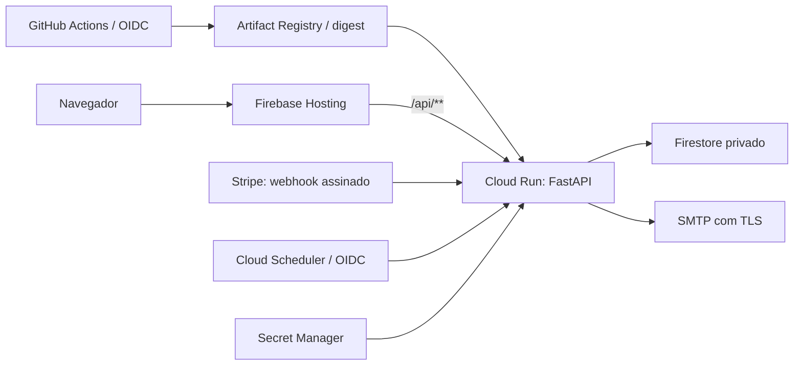

# Deploy: GitHub Actions, Google Cloud e Firebase

Este é o procedimento de lançamento e operação do Fundo Centenário. Firebase Hosting serve frontend/ diretamente; somente /api/** segue para Cloud Run. Firestore é a persistência de produção. Cloud Scheduler processa os agradecimentos durante requisições HTTP autenticadas.

O estado dos recursos e das verificações executadas está no [relatório de preparação](readiness-report.md). Não confunda comandos deste procedimento com etapas já executadas. Revise o código antes da publicação; commits e push são feitos por uma pessoa. Exemplos de terminal usam Bash no Google Cloud Shell; não copie a sintaxe de variáveis diretamente para PowerShell.

## Como executar este guia

Entre no [Google Cloud Console](https://console.cloud.google.com/) com
`rodrigo.vanzelotti@fundocentenario.com.br`. Confira o avatar e o projeto no
seletor superior antes de cada alteração. Os menus podem aparecer em português
ou inglês; use a busca superior para localizar um serviço se a posição variar.

Estado atualizado em 04/11/2026: faturamento, orçamento de R$60/mês, Firebase,
registry, Firestore/regras/índices/TTL/backups, IAM, WIF/GitHub e alertas foram
configurados. Staging e produção passaram no smoke privado com Firestore e
credenciais Stripe test/live próprias. O login SMTP foi validado, usuário/senha
estão fixados na versão `2`, email habilitado e Scheduler ativo. O frontend
público, liberação anônima Run após revisão humana e aceite final continuam
pendentes. Veja os recursos, versões e próximos passos no relatório
antes de repetir comandos de criação. Os checkboxes abaixo representam o fluxo
completo, não uma declaração de que tudo já foi lançado.

- [ ] [Faturamento ativo, projetos vinculados e orçamento](#21-reativar-a-conta-institucional).
- [ ] [Código revisado e terminal preparado](#24-preparar-o-código-e-o-cloud-shell).
- [ ] [Firebase, APIs, registry, banco, índices/TTL e IAM](#3-preparar-google-cloud-e-firebase).
- [ ] [Remetente Workspace e segredos](#4-segredos-e-stripe).
- [ ] [URL Run privada, destino Stripe e smoke autenticado](#5-primeiro-serviço-cloud-run-bootstrap-administrativo).
- [ ] [WIF, GitHub Variables, aprovação e deploy staging](#6-github-proteção-e-autenticação-federada).
- [ ] [Scheduler e agradecimento entregues em staging](#7-scheduler-e-ativação-dos-emails).
- [ ] [Aceite staging, backup, produção, domínio e operação](#9-aceite-de-staging-e-lançamento).

Prepare staging primeiro. Repita a configuração no projeto de produção antes de
solicitar produção. Os comandos de criação são para executar uma vez: se um
recurso existir, confira seus valores e avance, sem apagá-lo para repetir o guia.

## 1. Arquitetura e invariantes



- O browser nunca comprova pagamento. Apenas o webhook Stripe validado confirma contribuições.
- Cartões ficam no Checkout hospedado. Nome, email e CPF não entram na metadata Stripe.
- Intenções persistidas não contêm questionário. O browser mantém o questionário em `sessionStorage` e chama `/finalize` depois do pagamento confirmado.
- O cadastro do doador só é criado depois da confirmação, com autenticação pelo token da contribuição. O registro é criado uma vez, em transação.
- A primeira confirmação, a fatura recorrente e a outbox são gravadas em uma transação. IDs de documento determinísticos e transações coordenam instâncias distintas.
- Emails são processados somente quando existe pagamento e cadastro confirmado. Nenhum endpoint aceita destinatário/conteúdo arbitrários.
- `STORAGE_BACKEND=local` é exclusivo de desenvolvimento/testes. Stripe é usada em todos os ambientes. A pipeline injeta chaves test em staging e live em produção; ambos exigem Firestore.

O modo local continua disponível por `docker compose up --build`, com volume local privado e recarga automática. Não implante esse Compose no Google Cloud.

## 2. Decisões antes de criar recursos

1. Crie dois projetos distintos sob a conta institucional: staging e produção, com dados, identidades e segredos separados. Produção começa vazia: não importar `backend/data`, pagamentos ou assinaturas anteriores.
2. Vincule faturamento, habilite o plano Firebase Blaze nos próprios projetos e mantenha o orçamento de alerta autorizado de R$60/mês abrangendo ambos, com notificações em 50%, 80% e 100% e um responsável. Não configurar suspensão automática: ela pode interromper webhooks. O orçamento não é previsão nem teto de custo.
3. Use `southamerica-east1` para Cloud Run, Artifact Registry e Firestore, como no workflow e em `firebase.json`.
4. Use https://PROJECT.web.app em staging; produção usa https://fundocentenario.com.br. A URL nativa Run atende webhooks Stripe, Scheduler e smoke da API, independentemente do DNS do site. Não alterar DNS antes do checklist de migração.
5. Defina responsável por incidentes, reconciliação, cancelamentos, reembolsos e acesso aos dados. Configure finalidade e retenção do CPF, política de privacidade e contato de atendimento antes de divulgar o formulário.
6. Use uma caixa institucional Google Workspace existente e autorizada como remetente, com `SMTP_HOST=smtp.gmail.com`, `SMTP_PORT=587` e `SMTP_SECURITY=starttls`. Habilite verificação em duas etapas e crie uma senha de aplicativo exclusiva por ambiente, se a política Workspace permitir. Nunca use a senha normal da conta. Se o administrador bloquear senhas de aplicativo, resolva a política antes do lançamento: o backend não implementa OAuth SMTP. Valide SPF, DKIM e DMARC preservando registros existentes e teste entrega em caixas controladas. [Orientações Workspace](https://knowledge.workspace.google.com/admin/gmail/send-email-from-a-printer-scanner-or-app).

Não são necessários Kubernetes, Redis, Celery, uma segunda aplicação frontend, Firebase Authentication ou Firebase Admin SDK. Não instale um SDK Firebase no navegador para acessar dados de doadores.

Projetos criados para este lançamento na organização `fundocentenario.com.br` (`874989411514`), pela conta `rodrigo.vanzelotti@fundocentenario.com.br`:

| Configuração | Staging | Produção |
|---|---|---|
| Projeto | `fundocentenario-website-stg` | `fundocentenario-website-prd` |
| `PUBLIC_BASE_URL` / `CORS_ORIGINS` | `https://fundocentenario-website-stg.web.app` | `https://fundocentenario.com.br` |
| Stripe | test | live |
| `SMTP_HOST` | `smtp.gmail.com` | `smtp.gmail.com` |
| `EMAIL_FROM_ADDRESS` | `rodrigo.vanzelotti@fundocentenario.com.br` | `rodrigo.vanzelotti@fundocentenario.com.br` |

Use credenciais de aplicativo distintas para a mesma caixa em cada ambiente. A conta de faturamento institucional foi reativada e vinculada aos dois projetos. Não vincular faturamento pessoal por conveniência. As repository Variables `STAGING_GCP_PROJECT_ID=fundocentenario-website-stg` e `PRODUCTION_GCP_PROJECT_ID=fundocentenario-website-prd` já foram configuradas.

### 2.1 Reativar a conta institucional

Concluído nesta implantação. Use este procedimento somente se a conta voltar
a ficar fechada/inativa; não crie uma segunda conta para repetir a preparação.

1. Abra **Menu → Faturamento / Billing → Gerenciar contas de faturamento**.
2. Remova o filtro de contas ativas, se necessário, e abra a conta institucional
   com final `CA259F`. Não selecione a conta pessoal.
3. Abra **Gerenciamento da conta / Account management** e procure **Reabrir conta
   de faturamento / Reopen billing account**.
4. Resolva pendências de pagamento/perfil indicadas. Se o botão não estiver
   disponível, peça ao administrador do faturamento para reabrir a conta e
   conferir suas permissões.
5. Confirme o estado **Aberta / Open** antes de continuar.

Dados de pagamento devem ser preenchidos somente no painel Google, nunca no
repositório ou no chat. [Gerenciar e reabrir conta](https://docs.cloud.google.com/billing/docs/how-to/manage-billing-account).

### 2.2 Vincular os dois projetos

1. No seletor superior, escolha `fundocentenario-website-stg`.
2. Abra **Menu → Faturamento / Billing → Vincular conta de faturamento / Link a
   billing account**, se o projeto estiver sem vínculo.
3. Selecione a conta institucional ativa e confirme. Se já houver vínculo,
   confira a conta existente antes de alterar.
4. Repita com `fundocentenario-website-prd`.
5. Na conta de faturamento, abra **Gerenciamento da conta → Meus projetos / My
   projects** e confirme os dois IDs.

Resultado: faturamento ativo nos dois projetos. Erro de permissão exige acesso
de vínculo na conta e no projeto; não use faturamento pessoal como contorno.
[Vincular faturamento](https://docs.cloud.google.com/billing/docs/how-to/modify-project).

### 2.3 Criar orçamento de alerta

1. Abra **Faturamento → Orçamentos e alertas / Budgets & alerts → Criar orçamento**.
2. Nome: `Fundo Centenario - staging e producao`. Selecione apenas os dois projetos,
   todos os serviços e período mensal.
3. Use **R$60/mês**, valor autorizado para esta conta em BRL. O orçamento com
   esse valor já foi criado. Não o duplique nem substitua por US$10: a conta
   rejeitou a configuração em USD.
4. Configure limites de gasto real de **50%, 80% e 100%**.
5. Revise destinatários e salve. Defina quem responderá aos alertas; confirme o
   endereço se usar um canal de email do Monitoring.
6. Não configure desligamento automático de faturamento/serviços.

Resultado: orçamento salvo e destinatários definidos. Não é um teto de cobrança.
[Configurar orçamento](https://docs.cloud.google.com/billing/docs/how-to/budgets).

### 2.4 Preparar o código e o Cloud Shell

1. Uma pessoa deve revisar o diff local, publicar as alterações no GitHub e
   registrar o SHA aprovado. O agente não cria commits nem faz push.
2. No Console, clique em **Ativar Cloud Shell / Activate Cloud Shell**, na barra
   superior, e autorize o uso da conta institucional quando solicitado.
3. Clone o repositório revisado. Se for privado, use a autenticação GitHub
   autorizada pela instituição; não coloque token na URL de clone.

```bash
git clone https://github.com/RodrigoVanzelotti/fundo-centenario-website.git
cd fundo-centenario-website
git switch --detach SHA_APROVADO
git rev-parse HEAD
gcloud auth list --filter=status:ACTIVE --format='value(account)'
docker version
node --version
python --version
```

Substitua `SHA_APROVADO` pelo SHA real. Se o clone já existir, use `git fetch origin`
e confira alterações locais antes de mudar o checkout. Não sobrescreva trabalho.
Os comandos que usam `firebase.json`, `Dockerfile` ou `tools/` rodam nessa raiz.
Ao reabrir o terminal, entre na pasta e redefina as variáveis da seção 3.

A publicação inicial pode disparar staging antes do preparo dos recursos. Uma
falha por configuração ausente não provisiona o ambiente: conclua este guia e
execute o workflow novamente. Confirme CI verde antes de publicar para visitantes.

## 3. Preparar Google Cloud e Firebase

Execute para cada ambiente, substituindo os valores. As contas `fundo-runtime`, `fundo-deploy` e `fundo-scheduler` já foram criadas nos dois projetos; não as recrie. Confira o estado no relatório:

```bash
export PROJECT="fundocentenario-website-stg"
export DEPLOY_ENV="staging"
export REGION="southamerica-east1"
export SERVICE="fundo-centenario"
export REPOSITORY="fundo-images"
export RUNTIME_SA="fundo-runtime@$PROJECT.iam.gserviceaccount.com"
export DEPLOY_SA="fundo-deploy@$PROJECT.iam.gserviceaccount.com"
export SCHEDULER_SA="fundo-scheduler@$PROJECT.iam.gserviceaccount.com"

gcloud config set project "$PROJECT"
gcloud services enable run.googleapis.com artifactregistry.googleapis.com firestore.googleapis.com secretmanager.googleapis.com cloudscheduler.googleapis.com iam.googleapis.com iamcredentials.googleapis.com sts.googleapis.com cloudresourcemanager.googleapis.com firebase.googleapis.com firebasehosting.googleapis.com
gcloud artifacts repositories create "$REPOSITORY" --repository-format=docker --location="$REGION"
```

Em produção, use `PROJECT=fundocentenario-website-prd` e `DEPLOY_ENV=production`
e redefina as três variáveis de service account depois de trocar `PROJECT`.
Confira a seleção antes de executar qualquer outro bloco:

```bash
gcloud projects describe "$PROJECT" --format='yaml(projectId,projectNumber,parent)'
gcloud iam service-accounts list --project "$PROJECT" --format='table(email,disabled)'
```

As contas `fundo-runtime`, `fundo-deploy` e `fundo-scheduler` já estão criadas.
Confira em **IAM e administrador / IAM & Admin → Contas de serviço / Service
Accounts**. Não use a opção de gerar chave JSON.

### 3.1 Adicionar Firebase e ativar Blaze

1. Abra o [Firebase Console](https://console.firebase.google.com/) na mesma conta.
2. Clique em criar projeto; na parte inferior, escolha **Adicionar Firebase a um
   projeto do Google Cloud / Add Firebase to Google Cloud project**.
3. Selecione o ID existente do ambiente, abra o projeto e conclua o assistente.
   Aceite os termos quando solicitado; não crie um terceiro projeto.
4. Não habilite Google Analytics neste lançamento.
5. No indicador do plano, clique em **Fazer upgrade / Upgrade**, escolha **Blaze**
   e confirme o faturamento institucional. Se já mostrar Blaze, apenas confira.
6. Repita no outro projeto.

Resultado: cada ID aparece no Firebase, com dados separados.
[Adicionar Firebase ao projeto existente](https://firebase.google.com/docs/projects/use-firebase-with-existing-cloud-project).

### 3.2 Conferir APIs e Artifact Registry

O comando `gcloud services enable` acima habilita as APIs necessárias. Pela UI,
abra **APIs e serviços → APIs e serviços ativados / Enabled APIs & services**.
Para uma API ausente, use **Ativar APIs e serviços / Enable APIs and services**,
busque o nome e clique em **Ativar / Enable**. Resolva erros de billing na seção 2.

Para criar o registry pela UI em vez de `repositories create`:

1. Abra **Artifact Registry → Repositórios / Repositories → Criar repositório**.
2. Nome `fundo-images`, formato **Docker**, modo **Standard**.
3. Localização **Region**, região **southamerica-east1 (São Paulo)**.
4. Mantenha criptografia gerenciada pelo Google e crie.

Escolha UI ou CLI para criar; não precisa repetir a criação. Resultado:
`fundo-images` aparece na região correta. [Criar registry](https://docs.cloud.google.com/artifact-registry/docs/repositories/create-repos).

### 3.3 Criar o Firestore

No Firebase Console, adicione Firebase **ao projeto Google Cloud já escolhido**. Em Build → Firestore Database, crie `(default)` em modo Native/Standard, com regras de produção e a região escolhida. Não crie outro projeto Firebase por engano e não habilite acesso público ao banco.

1. Abra **Firebase → Build → Firestore Database → Criar banco de dados**.
   Alternativa: **Google Cloud → Firestore → Databases → Create database**.
2. Escolha edição **Standard**, modo **Native** se solicitado, ID **`(default)`**
   e localização **`southamerica-east1`**. Não selecione MongoDB/Datastore.
3. No assistente Firebase, escolha **modo de produção**, negando acesso de
   clientes. Aguarde a criação e não adicione doadores manualmente.
4. Confira o ID e a região no banco criado. A aplicação usará IAM.

Resultado: banco vazio e privado em cada ambiente.
[Criar banco](https://docs.cloud.google.com/firestore/native/docs/create-database-server-client-library).

### 3.4 Aplicar IAM mínimo

O servidor usa Application Default Credentials e sua service account. Regras Firebase bloqueiam SDKs clientes; elas não substituem IAM para os SDKs de servidor. Conceda acesso mínimo à identidade runtime:

```bash
gcloud projects add-iam-policy-binding "$PROJECT" --member="serviceAccount:$RUNTIME_SA" --role=roles/datastore.user
gcloud iam service-accounts add-iam-policy-binding "$RUNTIME_SA" --member="serviceAccount:$DEPLOY_SA" --role=roles/iam.serviceAccountUser
gcloud artifacts repositories add-iam-policy-binding "$REPOSITORY" --location="$REGION" --member="serviceAccount:$DEPLOY_SA" --role=roles/artifactregistry.writer
gcloud projects add-iam-policy-binding "$PROJECT" --member="serviceAccount:$DEPLOY_SA" --role=roles/firebasehosting.admin
gcloud projects add-iam-policy-binding "$PROJECT" --member="serviceAccount:$DEPLOY_SA" --role=roles/serviceusage.serviceUsageConsumer
```

Execute por ambiente. Para conferir na UI: **IAM e administrador → IAM** mostra
os papéis do projeto; **Artifact Registry → fundo-images → Permissões** mostra o
writer; **Contas de serviço → fundo-runtime → Permissões** mostra quem pode usar
a identidade. `run.developer` será aplicado ao serviço depois do bootstrap;
acesso a segredos é concedido na seção 4.

`roles/datastore.user` permite operações de dados no projeto. Por isso, staging e produção devem estar separados e esse principal não deve receber acesso a outros projetos. Não conceda Owner/Editor às identidades da aplicação ou do pipeline. [Identidade de serviço](https://docs.cloud.google.com/run/docs/configuring/services/service-identity).

### Regras, índices e TTL

Este é o passo 3.5. Na autenticação da CLI, selecione a conta institucional.
Não execute `firebase init`: os arquivos necessários já estão no repositório.

Na raiz do repositório, com uma conta administrativa autorizada:

```bash
npx --yes firebase-tools@15.32.1 login
npx --yes firebase-tools@15.32.1 deploy --project "$PROJECT" --only firestore:rules,firestore:indexes
```

Na UI Firebase, confira **Firestore Database → Rules / Regras** negando acesso
de clientes e **Indexes / Índices** com o índice da outbox ativado. No Google
Cloud Console, abra **Firestore → `(default)` → Time-to-live / TTL** e confira as
duas políticas habilitadas. Não basta o comando terminar: aguarde a construção.

Arquivos versionados:

- `firebase.json`: Hosting estático e rewrite /api/** para fundo-centenario em southamerica-east1 com pinTag; Firestore e emulador. Projeto explícito via --project.
- `firestore.rules`: nega todo acesso de clientes.
- `firestore.indexes.json`: índice de seleção dos emails, TTL para pendências e rate limits, e exclusão de índices desnecessários de PII/tokens.

Confirme no Console que o índice `fundo_thank_you_outbox` (`state`, `next_attempt_at`) terminou de construir antes de habilitar emails. Confirme também que as políticas TTL em `fundo_pending.expires_at` e `fundo_rate_limits.expires_at` estão ativas. TTL é limpeza assíncrona; a aplicação verifica expiração sem depender da exclusão física. Não configure TTL em confirmações ou cadastro sem uma política de retenção aprovada. [Índices](https://firebase.google.com/docs/firestore/query-data/indexing), [TTL](https://firebase.google.com/docs/firestore/ttl).

O prefixo padrão é `fundo_`. Se mudar `FIRESTORE_PREFIX`, ajuste os grupos de coleção do arquivo de índices/TTL antes do deploy. O workflow usa o prefixo padrão e o banco `(default)`.

### Backup e ensaio de restauração

Este é o passo 3.6. Pela UI de produção, abra **Google Cloud → Firestore →
Databases**. Na linha do `(default)`, use **Scheduled backups → Edit settings**,
abrindo **Disaster recovery / Recuperação de desastres**. Configure agenda diária,
retenção de sete dias e PITR desligado. Use UI ou o comando abaixo, sem duplicar
a criação da agenda.

Configure a agenda agora; conclua o ensaio de restauração depois que as
contribuições sintéticas da seção 9 tiverem gerado dados em staging e existir
um backup deles. Esse ensaio deve estar concluído antes do lançamento live.

Em produção, configure backup diário gerenciado com retenção de sete dias, sem PITR neste lançamento. Execute uma vez com uma identidade administrativa, somente no projeto de produção:

```bash
gcloud firestore backups schedules create --project "$PROJECT" --database='(default)' --retention=7d --recurrence=daily
gcloud firestore backups schedules list --project "$PROJECT" --database='(default)'
```

Antes do live, ensaie o mesmo mecanismo em staging com dados sintéticos. Aguarde um backup disponível, identifique seu nome e restaure em um banco separado, com ID ainda inexistente:

```bash
gcloud firestore backups list --project "$PROJECT" --location="$REGION"
gcloud firestore databases restore --project "$PROJECT" --source-backup="projects/$PROJECT/locations/$REGION/backups/ID_DO_BACKUP_SINTETICO" --destination-database=fundo-restore-test
```

Confira contagens, IDs, confirmações, cadastros e deduplicação no banco restaurado, sem habilitar SMTP nem apontar o serviço publicado para ele. Registre o resultado e confira índices/TTL antes de qualquer uso de recuperação. O banco restaurado contém uma cópia dos dados; mantenha acesso restrito. Backup/restauração têm cobrança própria. Não restaurar banco como rollback de código. [Agendamento](https://docs.cloud.google.com/sdk/gcloud/reference/firestore/backups/schedules/create), [restauração](https://docs.cloud.google.com/sdk/gcloud/reference/firestore/databases/restore).

Pela UI, os backups ficam em **Disaster recovery → Backups**. Selecione um
backup sintético e use **Restore** com um novo ID, nunca `(default)`. Aguarde o
primeiro backup se ainda não estiver disponível. Resultado: agenda de produção
salva e restauração sintética ensaiada antes do live.
[Backup pela UI](https://firebase.google.com/docs/firestore/backups).

## 4. Segredos e Stripe

### 4.1 Preparar o remetente Workspace

1. Entre na [Conta Google](https://myaccount.google.com/) de
   `rodrigo.vanzelotti@fundocentenario.com.br`.
2. Abra **Segurança → Como você faz login no Google → Verificação em duas etapas**
   e conclua a configuração.
3. Abra [Senhas de app](https://myaccount.google.com/apppasswords). Crie uma com
   nome `Fundo Centenario staging` e outra `Fundo Centenario producao`.
4. Coloque cada valor no segredo `smtp-password` do projeto correspondente;
   a tela pode mostrá-lo uma única vez. Não use a senha normal da conta.
5. Se a opção não aparecer, peça ao administrador Workspace para verificar a
   política. O backend não possui OAuth SMTP; não use relay sem autenticação.
6. Com o administrador, confira DKIM em **Admin Console → Apps → Google Workspace
   → Gmail → Authenticate email** e revise SPF/DMARC no DNS, preservando os
   registros existentes. O teste de entrega será feito na seção 7.

Resultado: senhas de aplicativo distintas e remetente autorizado.
[Senhas de app](https://support.google.com/accounts/answer/185833),
[SMTP Workspace](https://knowledge.workspace.google.com/admin/gmail/send-email-from-a-printer-scanner-or-app).

### 4.2 Criar os segredos no Console

1. Confira o projeto no seletor superior e abra **Secret Manager** pela busca.
2. Clique em **Criar secret / Create secret**. Use o nome exato da tabela abaixo
   e cole o valor somente no campo de conteúdo do segredo.
3. Mantenha replicação automática, salvo política institucional diferente, e crie.
4. Abra **Versões / Versions** e anote o número da versão habilitada, normalmente
   `1`. O número da versão não é secreto.
5. Repita para cada segredo e projeto.

Agora crie `stripe-secret-key`, `smtp-username` e `smtp-password`. O valor real
de `stripe-webhook-secret` será obtido no passo 5.2, depois de reservar a URL
Run. Não invente um segredo temporário para configurar a revisão real.
[Criar segredo](https://docs.cloud.google.com/secret-manager/docs/creating-and-accessing-secrets).

Crie os segredos no Secret Manager Console, colocando cada valor diretamente na interface e criando sua primeira versão:

| Segredo | Conteúdo | Necessário |
|---|---|---|
| `stripe-secret-key` | Chave secreta/restrita da conta correta | Sempre |
| `stripe-webhook-secret` | Segredo do destino de webhook desse ambiente | Sempre |
| `smtp-username` | Usuário do remetente SMTP | Com email habilitado |
| `smtp-password` | Senha/app password do remetente | Com email habilitado |

Em staging use Stripe test; em produção use live. Nunca reutilize o segredo da Stripe CLI como segredo do endpoint de produção. Não escreva os valores em comandos, YAML, arquivos versionados, Docker build args ou GitHub Variables.

`smtp-username` contém `rodrigo.vanzelotti@fundocentenario.com.br`. Para a chave
Stripe, no Dashboard selecione o ambiente sandbox/test ou live correto e abra
**Developers → API keys**. Guarde a chave secreta do ambiente no Secret Manager;
não use a chave pública `pk_...` no backend.

### 4.3 Conceder acesso por segredo

Conceda ao runtime acesso a cada segredo necessário, sem acesso indiscriminado ao projeto. Execute cada linha depois de criar o segredo correspondente; deixe a linha de webhook para depois do passo 5.2:

```bash
gcloud secrets add-iam-policy-binding stripe-secret-key --member="serviceAccount:$RUNTIME_SA" --role=roles/secretmanager.secretAccessor
gcloud secrets add-iam-policy-binding stripe-webhook-secret --member="serviceAccount:$RUNTIME_SA" --role=roles/secretmanager.secretAccessor
# A pipeline verifica test/live sem expor a chave:
gcloud secrets add-iam-policy-binding stripe-secret-key --member="serviceAccount:$DEPLOY_SA" --role=roles/secretmanager.secretAccessor
# Execute estes dois somente se o remetente estiver configurado:
gcloud secrets add-iam-policy-binding smtp-username --member="serviceAccount:$RUNTIME_SA" --role=roles/secretmanager.secretAccessor
gcloud secrets add-iam-policy-binding smtp-password --member="serviceAccount:$RUNTIME_SA" --role=roles/secretmanager.secretAccessor
```

Na UI, o equivalente é **Secret Manager → segredo → Permissões → Conceder
acesso**: informe a service account e escolha **Secret Manager Secret Accessor**.
Faça isso no segredo individual. O deploy lê somente `stripe-secret-key`; não
conceda a ele os outros três segredos.

Após obter `RUN_URL` no bootstrap privado, cadastre um destino Stripe por ambiente em `https://URL_NATIVA_DO_SERVICO/api/webhooks/stripe`, com snapshot events da própria conta, API `2026-10-28.endive` e os sete eventos listados em [INTEGRATION.md](../INTEGRATION.md). Use test em staging e live em produção; guarde o segredo específico do destino no projeto correspondente. Conclua o cadastro financeiro e confirme disponibilidade de Pix, cartão e assinatura na conta live. Mantenha versão da API, segredo e modo test/live alinhados.

As versões de segredos são numéricas e fixadas no deploy. Para rotacionar, crie uma nova versão, atualize as GitHub Variables correspondentes e implante nova revisão. Preserve versões antigas enquanto puder ser necessário rollback; revogue credenciais comprometidas independentemente dessa política. [Segredos no Cloud Run](https://docs.cloud.google.com/run/docs/configuring/services/secrets).

Não use `latest` nem defina `GOOGLE_APPLICATION_CREDENTIALS` no Cloud Run: a aplicação usa a identidade runtime sem chave JSON. Código versionado contém defaults e exemplos; GitHub Variables e Cloud Run contêm configurações não secretas e números de versões; valores secretos ficam exclusivamente no Secret Manager. Frontend recebe somente configuração pública e usa a API na mesma origem. `.env` local contém somente credenciais de desenvolvimento/teste.

## 5. Primeiro serviço Cloud Run: bootstrap administrativo

O workflow de CD exige um serviço já existente. O bootstrap é feito uma vez por um administrador, separado do deploy rotineiro.

### 5.1 Publicar a imagem e reservar uma URL privada

Pré-requisitos: checkout do SHA revisado, CI aprovado, projeto/variáveis da seção 3,
registry, IAM runtime e chave Stripe do ambiente guardada. Execute na raiz do
repositório, no Cloud Shell. A imagem inicial ficará visível em **Artifact Registry
→ fundo-images → fundo**. Não use **Deploy from source** nem **Connect repository**
do Console: a publicação rotineira já é feita pelo workflow deste repositório.

Construa e publique a primeira imagem revisada:

```bash
gcloud auth configure-docker "$REGION-docker.pkg.dev" --quiet
export IMAGE="$REGION-docker.pkg.dev/$PROJECT/$REPOSITORY/fundo:bootstrap-1"
docker build --platform linux/amd64 -t "$IMAGE" .
docker push "$IMAGE"
```

Para obter a URL inicial, crie o serviço **privado**, com credenciais sintéticas apenas para inicialização, sem email. Elas não autenticam chamadas à Stripe nem permitem criar pagamentos:

```bash
gcloud run deploy "$SERVICE" --region "$REGION" --image "$IMAGE" --service-account "$RUNTIME_SA" --port 8000 --no-allow-unauthenticated --set-env-vars APP_ENV=development,STORAGE_BACKEND=local,STRIPE_SECRET_KEY=sk_test_bootstrap_only,STRIPE_WEBHOOK_SECRET=whsec_bootstrap_only,EMAIL_ENABLED=false --max-instances 1 --quiet
export RUN_URL="$(gcloud run services describe "$SERVICE" --region "$REGION" --format='value(status.url)')"
```

Abra **Cloud Run → Serviços / Services → fundo-centenario** na região São Paulo.
Confira a exigência de autenticação e copie a URL nativa apresentada. Ela deve
corresponder ao `RUN_URL` do comando. Não derive a URL pelo nome do projeto e não
use a URL de uma tag candidata como endereço permanente.
[Implantar imagem no Cloud Run](https://docs.cloud.google.com/run/docs/deploying).

### 5.2 Cadastrar o webhook Stripe e guardar seu segredo

1. No Dashboard Stripe, selecione test/sandbox para staging e live para produção.
2. Abra **Workbench → Webhooks → Add destination / Adicionar destino**. Em layouts
   anteriores, o acesso pode estar em **Developers → Webhooks**.
3. Selecione eventos da **própria conta / Your account**, tipo **snapshot**, versão
   **`2026-10-28.endive`** e destino **Webhook endpoint**.
4. Informe a URL nativa Run seguida de `/api/webhooks/stripe`. O serviço ainda
   está privado nesta etapa; o recebimento será testado depois de torná-lo público.
5. Selecione exatamente os eventos abaixo e salve o destino.
6. Revele o **Signing secret** desse destino e crie `stripe-webhook-secret` no
   Secret Manager do mesmo ambiente, como no passo 4.2.
7. Anote a versão numérica e execute a concessão de acesso runtime desse segredo
   no passo 4.3. O segredo da CLI local não serve para esse destino.

```text
checkout.session.completed
checkout.session.async_payment_succeeded
checkout.session.async_payment_failed
checkout.session.expired
invoice.payment_succeeded
invoice.payment_failed
customer.subscription.deleted
```

Resultado: destino correto por ambiente e segredo guardado. Um evento de teste
genérico sem metadata da aplicação não comprova o fluxo de doação; o aceite usa
checkouts iniciados no formulário. [Criar destino Stripe](https://docs.stripe.com/webhooks).

### 5.3 Configurar a revisão real

No editor do Cloud Shell, crie `runtime.json` na raiz do checkout e cole o exemplo
abaixo. Troque todas as ocorrências de `SEU_PROJECT_ID` pelo ID selecionado e
`https://URL_NATIVA_DO_SERVICO` pelo `RUN_URL` obtido no passo 5.1, sem barra final.
Não coloque os valores dos segredos nesse arquivo. Em produção, altere também
`APP_ENV` e as duas origens para `https://fundocentenario.com.br`.

Não publique essa revisão de bootstrap. Ela serve somente para reservar o serviço/URL. Escolha `PUBLIC_BASE_URL=https://$PROJECT.web.app` em staging (domínio institucional em produção), cadastre o webhook Stripe, complete os segredos e prepare um arquivo `runtime.json` temporário com valores **não secretos**:

```json
{
  "APP_ENV": "staging",
  "STORAGE_BACKEND": "firestore",
  "GOOGLE_CLOUD_PROJECT": "SEU_PROJECT_ID",
  "FIRESTORE_DATABASE": "(default)",
  "FIRESTORE_PREFIX": "fundo_",
  "PUBLIC_BASE_URL": "https://SEU_PROJECT_ID.web.app",
  "CORS_ORIGINS": "https://SEU_PROJECT_ID.web.app",
  "SERVE_FRONTEND": "false",
  "PYTHON_DOTENV_DISABLED": "1",
  "STRIPE_API_VERSION": "2026-10-28.endive",
  "EMAIL_ENABLED": "false",
  "SCHEDULER_AUDIENCE": "https://URL_NATIVA_DO_SERVICO",
  "SCHEDULER_SERVICE_ACCOUNT": "fundo-scheduler@SEU_PROJECT_ID.iam.gserviceaccount.com",
  "INTENT_LIMIT_PER_MINUTE": "60",
  "EMAIL_BATCH_SIZE": "10"
}
```

Em produção altere `APP_ENV` para `production` e use os segredos live do projeto de produção. O modo Stripe é definido pelas credenciais, sem uma flag adicional. Não copie as credenciais test desse exemplo para o lançamento live.

No comando abaixo, substitua os sufixos `:1` se os números habilitados anotados
no Secret Manager forem diferentes. Mantenha `EMAIL_ENABLED=false` até o passo 7.2.

```bash
gcloud run deploy "$SERVICE" --region "$REGION" --image "$IMAGE" --service-account "$RUNTIME_SA" --port 8000 --env-vars-file runtime.json --set-secrets STRIPE_SECRET_KEY=stripe-secret-key:1,STRIPE_WEBHOOK_SECRET=stripe-webhook-secret:1 --memory 512Mi --cpu 1 --concurrency 20 --min-instances 0 --max-instances 3 --timeout 180 --cpu-throttling --startup-probe httpGet.path=/api/health,httpGet.port=8000,periodSeconds=10,timeoutSeconds=2,failureThreshold=12 --quiet
```

Antes de tornar público, faça smoke test com uma identidade humana que tenha `roles/run.invoker` no serviço:

O administrador que está executando este guia pode conceder esse papel somente
no serviço, sem torná-lo público ainda:

```bash
gcloud run services add-iam-policy-binding "$SERVICE" --region "$REGION" --member="user:rodrigo.vanzelotti@fundocentenario.com.br" --role=roles/run.invoker
```

```bash
export SMOKE_ID_TOKEN="$(gcloud auth print-identity-token)"
python tools/smoke.py "$RUN_URL" --production --api-only
unset SMOKE_ID_TOKEN
```

Resultado esperado: `HTTP smoke check passed`. Se falhar, consulte **Cloud Run →
fundo-centenario → Logs**. Erro 403 antes da aplicação sugere IAM/token; falha em
`/api/ready` pede revisão de Firestore, projeto e runtime SA. Não exponha o serviço
para contornar um teste privado com falha.

O parâmetro `--production` do smoke verifica proteções HTTP e métodos Stripe tanto em staging quanto em produção; não realiza cobrança.

Somente depois do teste, permita a invocação pública do site e dos webhooks. Um administrador pode executar:

```bash
gcloud run services add-iam-policy-binding "$SERVICE" --region "$REGION" --member=allUsers --role=roles/run.invoker
gcloud run services add-iam-policy-binding "$SERVICE" --region "$REGION" --member="serviceAccount:$DEPLOY_SA" --role=roles/run.developer
```

Na UI, confira **Cloud Run → fundo-centenario → Security / Segurança** para o
acesso público, e **Revisions / Revisões → revisão ativa** para imagem, conta
runtime, variáveis e referências de segredos. Os limites finais são 1 CPU,
512 MiB, concorrência 20 e mínimo 0/máximo 3 instâncias. Não publique Hosting
apontando para a revisão sintética do passo 5.1.

Se a política da organização impedir `allUsers`, resolva a exposição pública com o administrador de rede/IAM antes de liberar o formulário. Não torne dados do Firestore públicos para contornar isso. O endpoint de emails continua protegido na aplicação, pois IAM do serviço público não distingue rotas.

## 6. GitHub: proteção e autenticação federada

### 6.1 Criar environments e proteger produção

1. Abra o [repositório no GitHub](https://github.com/RodrigoVanzelotti/fundo-centenario-website)
   e entre em **Settings → Environments → New environment**.
2. Crie `staging` e depois `production`, com esses nomes exatos.
3. Em **production → Deployment protection rules**, habilite **Required reviewers**,
   selecione um responsável autorizado e marque **Prevent self-review**. Planeje
   que outra pessoa aprove quando quem iniciou o deploy estiver na lista de revisores.
4. Em **Deployment branches and tags**, permita somente a branch `main` nos dois
   environments.
5. Em **Settings → Rules → Rulesets** ou **Branches**, proteja `main` exigindo PR,
   revisão e o check de CI correspondente. Confira o nome do check na primeira
   execução; não selecione um nome inventado.

Se o plano GitHub não disponibilizar aprovação de environment, mantenha o deploy
de produção desabilitado até haver aprovação equivalente. Não considere o YAML
como prova de que as proteções da conta estão ativas.
[Configurar environments](https://docs.github.com/en/actions/how-tos/deploy/configure-and-manage-deployments/manage-environments).

No repositório, habilite Actions e crie os environments `staging` e `production`. Restrinja deploys à branch `main`, exija revisão de PR e torne obrigatório o job `check` do workflow CI nas execuções de PR. O deploy reutilizável pode exibi-lo como `ci / check`; confira o contexto de PR ao configurar a proteção. Exija revisores no environment de produção e impeça self-review; se o plano não suportar essa proteção, mantenha CD de produção desabilitado até definir aprovação equivalente. Esses controles são configurações do GitHub e não são ativados apenas por adicionar YAML.

O código adiciona:

- `.github/workflows/ci.yml`: testes em ambiente isolado, emulador Firestore, checks frontend, Compose, lock, auditoria de dependências, build e smoke test da imagem, scan de vulnerabilidades do container.
- `.github/workflows/deploy.yml`: CI → staging → produção manual/protegida; `deploy-environment.yml` reutiliza OIDC, imagem por digest, candidata, smoke, promoção e publicação Hosting.
- `.github/dependabot.yml`: acompanhamento semanal de dependências, imagens e Actions.

PRs não recebem identidade Google nem acesso a produção. Actions são fixadas por SHA; o job de deploy solicita somente `contents: read` e `id-token: write`. A service account de deploy lê somente `stripe-secret-key` para validar o modo antes do deploy, sem imprimir seu valor; não recebe acesso aos dados de doadores.

### Workload Identity Federation

Este é o passo 6.2. Use o Cloud Shell de cada projeto. A federação permite que o
job GitHub use a identidade de deploy sem uma chave JSON permanente.

Para obter os IDs numéricos, abra o [JSON do repositório na API GitHub](https://api.github.com/repos/RodrigoVanzelotti/fundo-centenario-website):
anote `id` na raiz e `owner.id`, não o nome do repositório ou do proprietário.
Se for privado e a API responder 404, consulte com GitHub CLI autenticada, em um
terminal onde `gh` esteja instalado:

```bash
gh auth login --hostname github.com --web
gh api repos/RodrigoVanzelotti/fundo-centenario-website --jq '{repository_id: .id, owner_id: .owner.id}'
```

Não copie o token de acesso. Transfira apenas os dois IDs numéricos para os
campos abaixo e confira `DEPLOY_ENV` antes da criação.

Crie pool/provider no projeto de cada ambiente com restrições ao repositório, branch e environment:

```bash
export PROJECT_NUMBER="$(gcloud projects describe "$PROJECT" --format='value(projectNumber)')"
export REPOSITORY_ID="ID_NUMERICO_DO_REPOSITORIO"
export OWNER_ID="ID_NUMERICO_DO_PROPRIETARIO"

gcloud iam workload-identity-pools create github --location=global --display-name="GitHub deployments"
gcloud iam workload-identity-pools providers create-oidc github --location=global --workload-identity-pool=github --issuer-uri=https://token.actions.githubusercontent.com --attribute-mapping="google.subject=assertion.sub,attribute.repository_id=assertion.repository_id,attribute.repository_owner_id=assertion.repository_owner_id" --attribute-condition="assertion.repository_id=='$REPOSITORY_ID' && assertion.repository_owner_id=='$OWNER_ID' && assertion.ref=='refs/heads/main' && assertion.environment=='$DEPLOY_ENV'"
gcloud iam service-accounts add-iam-policy-binding "$DEPLOY_SA" --role=roles/iam.workloadIdentityUser --member="principalSet://iam.googleapis.com/projects/$PROJECT_NUMBER/locations/global/workloadIdentityPools/github/attribute.repository_id/$REPOSITORY_ID"
```

No projeto staging, `DEPLOY_ENV` deve ser `staging`; em produção, `production`.
Na UI, abra **IAM e administrador → Workload Identity Federation → github →
provider github** e confira emissor, mapeamentos e condição. Para copiar o nome
completo do provider para o GitHub:

```bash
gcloud iam workload-identity-pools providers describe github --location=global --workload-identity-pool=github --format='value(name)'
```

Não remova as restrições para corrigir um erro de autenticação; confira os IDs, a branch e o environment do job. [Guia oficial de WIF](https://docs.cloud.google.com/iam/docs/workload-identity-federation-with-deployment-pipelines).

### Variables por environment

Este é o passo 6.3. Primeiro configure as duas variáveis do repositório em
**Settings → Secrets and variables → Actions → Variables → New repository variable**:

| Nome | Valor |
|---|---|
| `STAGING_GCP_PROJECT_ID` | `fundocentenario-website-stg` |
| `PRODUCTION_GCP_PROJECT_ID` | `fundocentenario-website-prd` |

Depois abra **Settings → Environments → staging → Environment variables → Add
environment variable**. Cadastre uma por vez conforme a tabela e repita em
`production` com os valores daquele projeto. São Variables, não GitHub Secrets:
as senhas/chaves permanecem no Secret Manager.

Em Settings → Environments → environment → Environment variables:

| Variable | Exemplo/finalidade |
|---|---|
| `GCP_PROJECT_ID` | ID do projeto desse ambiente |
| `GCP_REGION` | `southamerica-east1` |
| `CLOUD_RUN_SERVICE` | `fundo-centenario` |
| `ARTIFACT_REPOSITORY` | `fundo-images` |
| `GCP_WIF_PROVIDER` | `projects/NUMERO/locations/global/workloadIdentityPools/github/providers/github` |
| `DEPLOY_SERVICE_ACCOUNT` | Email de `fundo-deploy` |
| `RUNTIME_SERVICE_ACCOUNT` | Email de `fundo-runtime` |
| `PUBLIC_BASE_URL` | Origem HTTPS, sem caminho/query, sem barra final |
| `CLOUD_RUN_URL` | URL nativa HTTPS estável do serviço; audience do Scheduler |
| `SCHEDULER_SERVICE_ACCOUNT` | Email de `fundo-scheduler` |
| `EMAIL_ENABLED` | `false` no primeiro deploy; `true` após testar remetente e Scheduler |
| `SMTP_HOST` | `smtp.gmail.com`; obrigatório quando email estiver ativo |
| `EMAIL_FROM_ADDRESS` | Remetente autorizado |
| `EMAIL_REPLY_TO` | Atendimento; opcional |
| `STRIPE_API_VERSION` | `2026-10-28.endive`, igual ao backend e ao destino webhook |
| `STRIPE_SECRET_VERSION` | Versão numérica do segredo; padrão `1` |
| `STRIPE_WEBHOOK_SECRET_VERSION` | Versão numérica; padrão `1` |
| `SMTP_SECRET_VERSION` | Mesma versão numérica para usuário e senha SMTP; configuração atual `2` |

Não coloque chaves/senhas nessas Variables. O workflow usa STARTTLS/587 por padrão; se o provedor exigir SSL/465, altere os dois valores do bloco `env` em conjunto e revise o deploy. Texto, assunto e template têm defaults no backend e podem ser personalizados no mesmo bloco sem adicionar dados secretos.

Para evitar dúvida no preenchimento, use estes valores específicos:

| Variable | Staging | Produção |
|---|---|---|
| `GCP_PROJECT_ID` | `fundocentenario-website-stg` | `fundocentenario-website-prd` |
| `GCP_WIF_PROVIDER` | `projects/424614961062/locations/global/workloadIdentityPools/github/providers/github` | `projects/358530732475/locations/global/workloadIdentityPools/github/providers/github` |
| `DEPLOY_SERVICE_ACCOUNT` | `fundo-deploy@fundocentenario-website-stg.iam.gserviceaccount.com` | `fundo-deploy@fundocentenario-website-prd.iam.gserviceaccount.com` |
| `RUNTIME_SERVICE_ACCOUNT` | `fundo-runtime@fundocentenario-website-stg.iam.gserviceaccount.com` | `fundo-runtime@fundocentenario-website-prd.iam.gserviceaccount.com` |
| `SCHEDULER_SERVICE_ACCOUNT` | `fundo-scheduler@fundocentenario-website-stg.iam.gserviceaccount.com` | `fundo-scheduler@fundocentenario-website-prd.iam.gserviceaccount.com` |
| `PUBLIC_BASE_URL` | `https://fundocentenario-website-stg.web.app` | `https://fundocentenario.com.br` |
| `CLOUD_RUN_URL` | URL nativa obtida no staging, sem barra final | URL nativa obtida em produção, sem barra final |
| `EMAIL_FROM_ADDRESS` | `rodrigo.vanzelotti@fundocentenario.com.br` | `rodrigo.vanzelotti@fundocentenario.com.br` |

Nos dois environments, preencha também os nomes da tabela anterior:
`GCP_REGION=southamerica-east1`, `CLOUD_RUN_SERVICE=fundo-centenario`,
`ARTIFACT_REPOSITORY=fundo-images`, `EMAIL_ENABLED=false`,
`SMTP_HOST=smtp.gmail.com` e `STRIPE_API_VERSION=2026-10-28.endive`.
Use os números reais anotados no Secret Manager para as três Variables de versão.
O workflow usa um único `SMTP_SECRET_VERSION` para usuário e senha; mantenha as
versões escolhidas de ambos com o mesmo número. `EMAIL_REPLY_TO` pode ficar vazio
ou conter o endereço institucional aprovado para atendimento.

### 6.4 Conferir Hosting e executar staging

1. No Firebase do ambiente, abra **Build → Hosting** e confira o site padrão:
   o ID deve ser igual ao ID do projeto. O link final de staging será
   `https://fundocentenario-website-stg.web.app`.
2. No Cloud Shell, confira com `npx --yes firebase-tools@15.32.1 hosting:sites:list
   --project "$PROJECT"`. Se o padrão estiver ausente, crie com
   `npx --yes firebase-tools@15.32.1 hosting:sites:create "$PROJECT" --project
   "$PROJECT"`. Não rode `firebase init` nem configure outro public directory.
3. No GitHub, abra **Actions → Deploy → Run workflow**, selecione branch `main`,
   ambiente `staging` e confirme.
4. Abra a execução. Aguarde CI e staging verdes; confira os logs dos passos de
   smoke e publicação Hosting, sem copiar tokens/credenciais para relatórios.
5. No resumo, registre SHA, digest da imagem e revisão Run. No Firebase Hosting,
   registre a versão/release correspondente e sua mensagem de publicação.
6. Abra `/` e `/como-apoiar/` no web.app staging. Confira no DevTools → Network os
   headers `X-Robots-Tag: noindex, nofollow` das páginas. Não use dados reais.

Resultado: site staging publicado pelo workflow, com API e frontend do mesmo SHA.
O Hosting `pinTag` vincula a versão estática à revisão Run testada; não há promoção
de imagem entre os projetos. [Sites Hosting](https://firebase.google.com/docs/hosting/multisites).

Após configurar e publicar manualmente as alterações revisadas no GitHub, use Actions → Deploy → Run workflow → `staging`. Faça a validação Stripe antes de promover produção. Push em `main` executa somente staging. Despacho manual para produção executa CI e staging do mesmo SHA antes do job de produção, que aguarda aprovação do environment.

Se o smoke da candidata falhar, o workflow não altera o tráfego existente. Investigue a revisão candidata e remova sua tag após diagnóstico. Não promova manualmente uma candidata sem entender a falha. [Rollouts e rollback](https://docs.cloud.google.com/run/docs/rollouts-rollbacks-traffic-migration).

## 7. Scheduler e ativação dos emails

### 7.1 Criar o job

No Console do projeto, busque **Cloud Scheduler → Criar job / Create job**.
Se a API estiver desabilitada, habilite-a conforme a seção 3. Preencha:

| Campo | Valor |
|---|---|
| Nome | `fundo-thank-you` |
| Região | `southamerica-east1` |
| Frequência | `*/5 * * * *` |
| Fuso | `America/Sao_Paulo` |
| Destino | HTTP |
| URL | URL nativa Run do ambiente + `/api/internal/emails/process` |
| Método | POST |
| Autenticação | Add OIDC token |
| Conta de serviço | `fundo-scheduler` do mesmo projeto |
| Audience | URL nativa Run, sem caminho e sem barra final |
| Attempt deadline | 180 segundos |
| Máximo de retries | 3 |

Salve. Se a UI não mostrar algum campo avançado, use o comando completo abaixo
em vez de criar pela UI. Não crie um segundo job com nome diferente.
[Criar Scheduler](https://docs.cloud.google.com/scheduler/docs/creating).

O worker permanente só roda no modo local. No Firestore, a outbox é consultada e processada durante `POST /api/internal/emails/process`. O handler verifica assinatura/issuer do token Google, audience, email e `email_verified`. Não confia em headers `X-CloudScheduler-*` como autenticação.

Crie o job antes de habilitar envio:

```bash
gcloud scheduler jobs create http fundo-thank-you --location="$REGION" --schedule="*/5 * * * *" --time-zone="America/Sao_Paulo" --uri="$RUN_URL/api/internal/emails/process" --http-method=POST --oidc-service-account-email="$SCHEDULER_SA" --oidc-token-audience="$RUN_URL" --attempt-deadline=180s --max-retry-attempts=3
```

O operador que cria o job precisa de permissão para usar essa service account. Preserve o papel de service agent do Cloud Scheduler; não entregue uma chave JSON ao job. Como o serviço é público, a verificação por rota ocorre no código. [Scheduler com Cloud Run](https://docs.cloud.google.com/run/docs/triggering/using-scheduler).

No runtime confira `SCHEDULER_AUDIENCE=$RUN_URL` e `SCHEDULER_SERVICE_ACCOUNT=$SCHEDULER_SA`. Preencha remetente e segredos, altere `EMAIL_ENABLED=true` no environment e faça novo deploy. Execute o job manualmente pelo Console somente quando houver uma contribuição de teste autorizada no projeto staging.

### 7.2 Habilitar e testar agradecimentos

1. Confira que as versões de `smtp-username` e `smtp-password` estão habilitadas
   e acessíveis ao runtime e que o índice da outbox está pronto.
2. No GitHub, abra **Settings → Environments → staging → Environment variables**,
   altere `EMAIL_ENABLED` para `true` e confira host, remetente e versão SMTP.
3. Execute **Actions → Deploy → Run workflow → staging** novamente. Alterar a
   Variable sozinha não muda o Cloud Run: é necessário o deploy.
4. Faça uma nova contribuição de teste pelo formulário, usando uma caixa
   controlada pela equipe. Finalize o cadastro depois da confirmação.
5. No Console, abra **Cloud Scheduler → fundo-thank-you → Force run / Executar
   agora**. Aguarde sucesso e confira o email recebido, incluindo pasta de spam.
6. Em falha, veja **Cloud Run → fundo-centenario → Logs**. Falha OIDC pede revisão
   de audience/conta; falha SMTP pede revisão de senha de aplicativo/remetente.
   Confirme que o item continua pendente na outbox, sem apagá-lo.

Contribuições criadas com email desabilitado não geram um novo pedido de email
retroativo quando ele é ativado. Faça o teste após habilitar. Em produção, repita
a configuração no environment production e use o workflow de produção protegido.

Cada execução seleciona até 10 registros e para de iniciar novos envios após 50 segundos. Cada registro tem lease de 5 minutos, aquisição transacional e retries com atraso limitado a uma hora. Uma requisição sem cadastro confirmado adia o job; nunca envia o questionário antes do pagamento. O retry pode continuar após reinício ou troca de instância.

SMTP não garante entrega exatamente uma vez. Se aceitar o email e o processo encerrar antes de registrar o envio, o retry pode duplicá-lo; `Message-ID` é estável. Aceitação SMTP não comprova entrega na caixa de entrada. Uma garantia maior exige serviço de email com idempotência, não apenas outro lock.

## 8. Produção vazia e migração fora deste lançamento

**Decisão deste lançamento: produção começa vazia. Não execute a importação abaixo, não envie arquivos locais nem vincule assinaturas anteriores.** O procedimento fica apenas como referência para uma migração futura expressamente autorizada e conciliada.

Não envie os dados locais ao GitHub ou ao build Docker. O modo Firestore não lê/migra `backend/data` automaticamente.

1. Pause novas contribuições no sistema anterior e deixe os pagamentos pendentes serem conciliados. Os registros antigos em memória não serão transferidos; não desligue o processo sem planejar sua recuperação.
2. Faça backup privado dos JSONL, restrito e criptografado. Mantenha uma cópia imutável para recuperação.
3. Reconcile pagamentos e assinaturas com a conta Stripe correta. Não importe pagamentos simulados antigos ou registros sem comprovação. Assinaturas anteriores sem metadata exigem reconciliação específica conforme `INTEGRATION.md`.
4. Instale as dependências em um ambiente isolado e obtenha ADC com uma identidade administrativa temporária autorizada.
5. Valide primeiro uma cópia protegida do backup, sem acesso remoto:

```bash
python tools/migrate_jsonl.py --source /CAMINHO_PRIVADO/backup
```

6. Teste a importação no projeto staging antes de produção. Para aplicar a fonte já conciliada:

```bash
gcloud auth application-default login
python tools/migrate_jsonl.py --source /CAMINHO_PRIVADO/backup --project "$PROJECT" --apply --confirmed-source
```

O comando preserva IDs, primeira confirmação, faturas, cadastro e marcadores de email enviado. É idempotente; pode ser repetido após falha parcial. Ele não chama SMTP e não cria novos emails retroativos. Para preservar explicitamente pedidos de email ainda pendentes da fonte, acrescente `--include-pending-emails` depois de revisar os destinatários/estado. Nunca importe um backup de staging/testes em produção.

Compare contagens e amostras de referências com a fonte e a Stripe, sem copiar PII para logs. Registros de cadastro devem possuir confirmação correspondente. Não restaure o banco inteiro depois de novos pagamentos sem reconciliar os eventos posteriores; isso pode desfazer deduplicação.

## 9. Aceite de staging e lançamento

### 9.1 Validar staging publicado

Execute o smoke no Cloud Shell; ele não cria pagamento nem envia email:

```bash
python tools/smoke.py https://fundocentenario-website-stg.web.app --production
```

Depois faça a validação funcional com dados sintéticos e métodos de teste
oficiais da Stripe. Não insira cartão real em staging:

| Teste | Como fazer e o que conferir |
|---|---|
| Desktop e celular | Abra home e contribuição nos dois dispositivos; complete o formulário, volte uma etapa e confira se os dados permanecem |
| Pix, cartão e mensal | Inicie cada método pelo formulário e conclua no Checkout de teste; confira o pagamento/evento no Dashboard Stripe e a confirmação no site |
| Recusa e cancelamento | Use os casos oficiais de teste Stripe e cancele um Checkout; confira a mensagem de recuperação e uma nova tentativa |
| Pendência e expiração | Deixe um Checkout não pago e use a expiração suportada pela Stripe; confira que não aparece confirmação ou cadastro de doador |
| Redirect | Retorne ao formulário sem concluir o pagamento; a tela não pode marcar a contribuição como paga |
| Webhook inválido | O smoke envia POST sem assinatura e exige HTTP 401; não basta testar GET da rota |
| Webhook duplicado | Em Workbench → Webhooks → destino → entregas, reenvie um evento real do Checkout criado no staging; confira que não surge segunda confirmação, fatura ou cadastro |
| PII e finalize | Antes de pagar, confira no Firestore que não há cadastro do doador sintético; depois do webhook, retorne ao site com a mesma sessão e confira que `/finalize` grava um cadastro, sem duplicação ao repetir |
| SMTP | Faça uma nova contribuição com email ativo, execute Scheduler e confira a caixa controlada; ensaie falha SMTP somente no staging, restaure a configuração e confirme retry sem apagar a outbox |
| Reinício/escala | Guarde o token apenas na sessão do browser; aguarde escala a zero ou faça novo deploy sem perder a sessão, e confira que pending/paid continuam disponíveis pelo Firestore |
| Backup/rollback | Execute a restauração sintética do passo 3.6 e o ensaio de rollback abaixo; registre resultado e versões usadas |

Para consultar registros, use **Google Cloud → Firestore → `(default)` → Data**,
com acesso administrativo restrito. As coleções incluem `fundo_pending`,
`fundo_payment_confirmations`, `fundo_confirmed_donations`,
`fundo_recurring_payments` e `fundo_thank_you_outbox`; confira os nomes no banco.
Não copie CPF, email, tokens ou payloads completos para relatório/prints públicos.
Nos testes de finalização, use DevTools → Network somente para observar o status
das chamadas; não transfira o token da sessão para a URL.

Para escala a zero, **Cloud Run → fundo-centenario → Metrics** mostra a contagem
de instâncias. O tráfego periódico do Scheduler e os monitores podem impedir um
intervalo ocioso durante o ensaio; registre o que foi efetivamente observado,
sem declarar escala a zero apenas porque o mínimo está configurado como zero.
Se pausar um job em staging para o ensaio, retome-o ao terminar.

Use os [cenários oficiais de teste Stripe](https://docs.stripe.com/testing) para
cartões/recusas. Pix Automático não é um método oferecido nesta implementação.

Registre evidências no ambiente publicado; o eval Stripe local não substitui este aceite:

- [ ] Páginas e `/como-apoiar/` funcionam em desktop e celular.
- [ ] Pix pontual, cartão pontual e assinatura mensal completam no Checkout hospedado com credenciais test; recusa, cancelamento e expiração permitem recuperar o fluxo.
- [ ] Redirect não confirma pagamento; webhook inválido é rejeitado e reenvio não duplica confirmação, cadastro ou fatura.
- [ ] Nome, email e CPF não aparecem no cadastro antes da confirmação; `/finalize` autenticado grava uma vez no Firestore.
- [ ] Scheduler OIDC envia agradecimento a uma caixa controlada; falha SMTP permanece pendente para retry.
- [ ] Reinício e escala a zero preservam pagamentos e pendências; rollback restaura Hosting e a revisão Run correspondente.
- [ ] Índice da outbox, TTL, IAM, segredos versionados, alertas e restauração de backup sintético foram verificados.

Depois do aceite, revisão humana e publicação manual do código no GitHub, implante produção pelo workflow protegido, com credenciais live e email validado. O pipeline testa e publica imagens por digest em cada projeto, do mesmo SHA aprovado; não há promoção de imagens entre projetos.

### 9.2 Solicitar produção

1. Confira que o projeto `fundocentenario-website-prd` passou pelo preparo das
   seções 3–7: credenciais live, webhook próprio, Cloud Run real, índice/TTL,
   backups, Scheduler e remetente configurados. Deixe o banco sem importações.
2. Confira as Variables de production, especialmente origem final, referências
   de segredos live e `EMAIL_ENABLED=true` depois da validação do remetente.
3. No GitHub, abra **Actions → Deploy → Run workflow**; branch **main**, environment
   **production**. Registre o SHA selecionado.
4. Aguarde CI e staging desse mesmo SHA passarem. O job production deve aguardar
   em **Review deployments**; o revisor designado deve conferir os resultados
   e aprovar pelo botão de revisão.
5. Espere production verde. Confira resumo do workflow e histórico Firebase
   Hosting, registrando SHA, digest, revisão Run e versão Hosting.
6. Use `python tools/smoke.py https://fundocentenario-website-prd.web.app
   --production` no Cloud Shell. O domínio web.app verifica transporte/arquivos;
   o Checkout e CORS de produção ainda precisam do teste no domínio final.

Resultado: artefatos de produção publicados, ainda sujeitos à validação do domínio.
Um job vermelho depois de promover Run pode exigir rollback; não interprete
publicação parcial como sucesso.

### 9.3 Conectar o domínio sem interromper o Workspace

1. No provedor DNS atual, exporte a zona completa e guarde uma cópia privada com
   data e responsável. Preserve os valores antigos de A/AAAA/CNAME web.
2. Confirme o inventário de páginas e documentos do [checklist de migração](migration-checklist.md).
   Não remova o site anterior antes de validar seus destinos.
3. Abra **Firebase Console → projeto de produção → Build → Hosting → Add custom
   domain / Adicionar domínio personalizado**.
4. Informe `fundocentenario.com.br`. Como já há site no domínio, siga **Advanced
   Setup / Configuração avançada** do assistente.
5. No DNS, adicione somente os registros de verificação/preparação indicados
   para esse site. Aguarde a preparação do certificado conforme o assistente;
   confira CAA com o operador se houver erro de emissão.
6. Adicione `www.fundocentenario.com.br` no mesmo Hosting e configure-o para
   redirecionar ao apex, preservando caminhos. Verifique TLS nos dois hosts.
7. Quando o assistente autorizar a mudança de tráfego, altere apenas os registros
   web A/AAAA/CNAME indicados. Não use IPs genéricos de tutoriais. Preserve NS,
   MX e TXT/CNAME de SPF, DKIM, DMARC e verificações institucionais.
8. Confira no Firebase o estado **Connected / Conectado** e abra home,
   `/como-apoiar/` e páginas institucionais nos dois hosts.
9. Execute `python tools/smoke.py https://fundocentenario.com.br --production`.
   Confira no DevTools: HTTPS, chamadas `/api/**` na mesma origem e ausência de
   `X-Robots-Tag: noindex` nas páginas de produção. Teste envio/recebimento Workspace.

O webhook Stripe continua na URL nativa Run, sem depender da propagação DNS.
Se a migração falhar, restaure os registros web do export e mantenha o backend
ativo para receber webhooks. [Domínio e migração avançada](https://firebase.google.com/docs/hosting/custom-domain).

Para o domínio, siga [migração/DNS](migration-checklist.md): exporte a zona atual; adicione apex e `www` pelo Advanced Setup do Firebase e aguarde o preparo do certificado. Altere somente os registros web indicados, preservando NS, MX e registros Workspace. Use apex como canonical e redirecione `www` preservando caminhos. Confira HTTPS, páginas, API, CORS e ausência de `noindex` em produção.

Antes da divulgação, realize contribuições reais controladas e autorizadas por Pix, cartão e assinatura, confira webhook, cadastro e email e cancele a assinatura de teste. Publique o sitemap no Search Console e divulgue o formulário somente após esses resultados. A política de privacidade deve informar finalidade e retenção dos dados, incluindo CPF, e contato de atendimento. Não adicionar analytics ao formulário neste lançamento.

Na Stripe live, acompanhe **Payments**, **Billing → Subscriptions** e as entregas
do destino de webhook. Depois do pagamento mensal de teste, abra a assinatura e
cancele-a, conferindo que não haverá nova cobrança. Não marque pagamentos como
pagos manualmente para satisfazer o aceite. No Search Console, use a propriedade
verificada do domínio → **Sitemaps** e envie `https://fundocentenario.com.br/sitemap.xml`
somente após concluir a validação final.

### 9.4 Configurar os avisos mínimos e a rotina

1. No Google Cloud, abra **Monitoring → Alerting → Edit notification channels**
   e configure/verifique o email do responsável.
2. Em **Monitoring → Uptime checks → Create uptime check**, crie um teste HTTPS
   para `fundocentenario.com.br/api/health`, frequência de cinco minutos e alerta
   conforme [operações](operations.md). Teste o canal de notificação.
3. Em **Monitoring → Alerting → Create policy**, selecione Cloud Run e a métrica
   de contagem de requisições, filtre o serviço e respostas 5xx e aplique os
   limites de operação. Configure também aviso para falhas/atraso do Scheduler.
   Use a busca do seletor de métricas; não crie dashboards próprios para isso.
4. No destino Stripe, confira as notificações de falha de entrega e o email
   cadastrado da equipe.
5. Diariamente na primeira semana, compare pagamentos Stripe, confirmações,
   cadastros e agradecimentos; depois passe a revisão semanal. Investigue
   pagamentos sem cadastro com atendimento restrito, sem aceitar redirect como prova.

Resultado: destinatários verificados, avisos testados e responsável pela rotina.
Os parâmetros de alerta e a retenção estão em [operação](operations.md).
[Uptime checks](https://docs.cloud.google.com/monitoring/uptime-checks),
[políticas de alerta](https://docs.cloud.google.com/monitoring/alerts/using-alerting-ui).

### 9.5 Ensaiar e executar rollback

1. Identifique a última release estável e sua revisão Run no registro de publicação.
2. No **Firebase → Hosting → Release history / Histórico de versões**, selecione
   a release anterior e use **Rollback**. O `pinTag` restaura a referência Run
   daquela versão junto com o frontend.
3. Restaure também o tráfego da URL nativa Run, usada por Stripe e Scheduler:

```bash
gcloud run services update-traffic "$SERVICE" --project "$PROJECT" --region "$REGION" --to-revisions REVISAO_ESTAVEL=100
python tools/smoke.py "https://$PROJECT.web.app" --production
python tools/smoke.py "$RUN_URL" --production --api-only
```

Substitua `REVISAO_ESTAVEL` pelo nome registrado. Na UI Run, a alternativa é
**fundo-centenario → Revisions → Manage traffic**, encaminhando 100% à revisão
estável correspondente. Confira também o domínio final em produção. Não restaure
Firestore como rollback de código e não apague outbox ou eventos para corrigir
uma release. Mantenha versões de segredos/imagens necessárias à recuperação.

Registre SHA, digest, revisão Run e versão Hosting de cada publicação. Mantenha alerta HTTPS, alerta de 5xx/falhas do Scheduler e notificações Stripe de falhas de webhook. Confira pagamentos versus cadastros e emails diariamente na primeira semana, depois semanalmente. Siga [operação e rollback](operations.md), mantendo o endpoint Stripe ativo durante recuperação. Os limites conhecidos são possível duplicação de email após falha SMTP e necessidade de atendimento quando o doador perde a sessão antes de finalizar o cadastro.

## 10. Manutenção e testes locais

Runtime Linux/Python 3.12 usa `backend/requirements.lock`, com versões e hashes. Após alterar `backend/requirements.txt`, gere o lock novamente em Linux e revise o diff; Dependabot não dispensa essa revisão:

```bash
docker run --rm -v "$PWD:/workspace:ro" -w /workspace python:3.12-slim@sha256:02108f5d322dd89f1c9e552442c25acb0543dfdbc455693a5599624f20d9155d python tools/lock_requirements.py > backend/requirements.lock
python tools/lock_requirements.py --check
```

Em Windows, use `requirements.txt` para o venv local, pois o lock é resolvido para Linux. A imagem e o CI sempre usam o lock. Não gere o arquivo com redirecionamento UTF-16 do PowerShell antigo; use Bash ou capture stdout em Python e grave UTF-8.

Para testar persistência remota localmente, inicie o emulator e execute os testes com um projeto fictício:

```bash
docker run --rm -p 127.0.0.1:8085:8085 gcr.io/google.com/cloudsdktool/google-cloud-cli:emulators@sha256:8d8573471c489a409f03891d2c24d177fa531276184f7002b9a2d853d1b3ed54 gcloud emulators firestore start --host-port=0.0.0.0:8085 --project=demo-fundo-centenario
# Em outro terminal, no venv:
pip install -r backend/requirements.txt -r backend/requirements-dev.txt
FIRESTORE_TEST_HOST=127.0.0.1:8085 REQUIRE_FIRESTORE_TESTS=1 python -m pytest -q
node tests/frontend-static.test.js
node tests/institutional-static.test.js
node tests/donation-steps.test.js
```

Sem emulator, os testes locais de Firestore são pulados; o CI exige sua execução. Os testes usam dados sintéticos e desabilitam a leitura de `.env`, sem cobrar cartões nem enviar emails reais. O emulator não reproduz IAM, regras de SDK cliente, construção de índices, billing ou todos os comportamentos do serviço gerenciado: valide esses itens no staging antes do live.

## Hosting, isolamento e aprovação de release

`frontend/` é o build de produção: sem compilador ou dependências npm no produto.
O container preserva os arquivos para desenvolvimento; no deploy usa
`SERVE_FRONTEND=false`. HTML, JS e CSS revalidam a cada acesso; imagens têm cache
de uma hora. Não usar immutable em nomes sem hash. API responde no-store, inclusive
erros. Sem fallback SPA: arquivos ausentes retornam 404. `/como-apoiar/` é um
diretório real; refresh não depende de estado de navegação.

Defina repository Variables `STAGING_GCP_PROJECT_ID` e `PRODUCTION_GCP_PROJECT_ID`,
distintas. Cada environment mantém `GCP_PROJECT_ID` e as variáveis da tabela acima.
O workflow rejeita divergência, projetos iguais e runtime SA fora do projeto.
Crie o site Hosting padrão em cada projeto. `GCP_REGION=southamerica-east1` e
`CLOUD_RUN_SERVICE=fundo-centenario` devem corresponder ao rewrite em `firebase.json`.
Não presumir disponibilidade dos nomes sugeridos ou existência de recursos.

Configure required reviewers, impedir self-review e branch main no environment
production. Restrinja alterações em workflows/environments/variables. Um dispatch
production solicita a promoção, mas aprovação deve considerar o resultado staging
e os gates institucionais. Esses controles exigem configuração real no GitHub.

Além dos papéis anteriores, a identidade de deploy precisa de
`roles/firebasehosting.admin` e `roles/serviceusage.serviceUsageConsumer` no próprio
projeto. `pinTag` atualiza tags Run e precisa das permissões run.developer no serviço.
Verifique em staging; não conceder Owner/Editor para contornar erros. Runtime não
recebe esses papéis de deploy. Firebase CLI usa ADC do OIDC, sem chave JSON ou
FIREBASE_TOKEN. Versão da CLI: 15.32.1, igual aos comandos administrativos.

O workflow é a configuração declarativa existente do serviço; Firebase JSON define
Hosting/Firestore. Bootstrap e IAM permanecem comandos administrativos explícitos,
sem introduzir Terraform. O projeto nunca é escolhido por alias implícito.

Ordem: CI → staging (imagem por digest, candidata sem tráfego, smoke API, tráfego
Run, Hosting pinTag, smoke web.app) → aprovação de produção, quando solicitada →
mesmos passos no projeto isolado. Hosting publica exatamente o checkout do mesmo
SHA da API. Regras/índices são preparação administrativa, não mudanças implícitas
em cada release. Smoke testa GET e POST rejeitado no webhook sem criar pagamentos.
Falhas após a promoção exigem rollback coordenado: Run e Hosting não são atômicos.

Staging recebe `X-Robots-Tag: noindex, nofollow` gerado pelo workflow. Isso não é
autenticação; use somente dados sintéticos. Preview Channels são opcionais para
revisão visual e devem usar somente o projeto staging; retorno Stripe continua na
origem staging configurada, onde deve ocorrer a validação funcional completa.

No bootstrap, publique Hosting somente após candidata validada:

```bash
npx --yes firebase-tools@15.32.1 deploy --project "$PROJECT" --only hosting --non-interactive
python tools/smoke.py "https://$PROJECT.web.app" --production
```

No staging manual acrescente o header noindex antes da publicação, como no workflow.
Smoke web.app antes do DNS verifica transporte e arquivos; checkout/CORS precisam
também ser verificados no domínio final. Não adivinhar registros DNS.

Fontes: [Hosting/pinTag](https://firebase.google.com/docs/hosting/cloud-run),
[OIDC e ADC](https://github.com/google-github-actions/auth),
[proteções de environments](https://docs.github.com/en/actions/managing-workflow-runs-and-deployments/managing-deployments/managing-environments-for-deployment).

